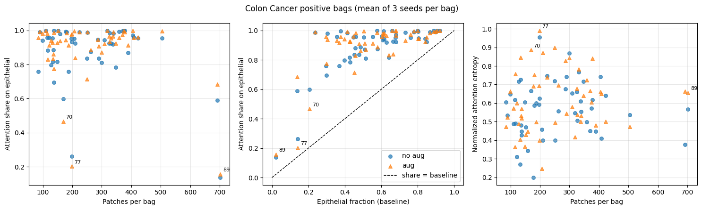

# Attention-based Deep MIL — Reproduction

PyTorch reproduction of Ilse et al. (2018), [*Attention-based Deep Multiple Instance Learning*](https://arxiv.org/abs/1802.04712).

- 목표: 새 모델 제안 X. 논문 핵심 주장 확인 — "attention 가중치가 bag 라벨을 결정하는 instance를 짚어낸다"
- 데이터: MNIST-bags (파이프라인 검증) → Colon Cancer (실제 병리 패치)
- 구현 범위: 기본 attention (`tanh`)만. Gated Attention 미구현

## Table of Contents

- [Background](#background)
- [Results](#results)
- [Method](#method)
- [Getting Started](#getting-started)
- [Project Structure](#project-structure)
- [Limitations](#limitations)
- [Notes on AI Assistance](#notes-on-ai-assistance)
- [References](#references)

## Background

**Multiple Instance Learning (MIL)**
- bag 하나에 instance 여러 개, 라벨은 bag 단위로만 존재 (weakly supervised)
- 예: 병리 슬라이드(bag) 안 패치(instance) 여러 개, 암세포 패치 1개라도 있으면 양성

**Attention pooling**

```
a_k = softmax_k( wᵀ tanh(V h_k) )
z   = Σ_k a_k h_k
```

- `h_k`: instance 임베딩, `a_k`: 학습된 가중치, `z`: bag 벡터
- `a_k` = 모델이 어느 instance를 근거로 판단했는지 보여주는 값

## Results

> 작성자 실행 결과 (Colab GPU). README 작성 시 재실행 확인 X. 시드·환경에 따라 달라질 수 있음.

### 1. MNIST-bags — 파이프라인 검증

- 라벨: bag 안에 숫자 `9`가 1개 이상이면 1

| 항목 | 값 |
|---|---|
| Train / Test bags | 250 / 50 |
| Epochs | 20 |
| Test error | **0.06** (acc 94%) |

- positive bag 1개 확인: `9` instance 2개에 attention 약 99.95% 집중 (0.7418 + 0.2577), 나머지 숫자 ≈ 0

### 2. Colon Cancer — 분류 성능

- H&E 조직 이미지 27×27 패치, 99 bags (positive 52%)
- 평가: 층화 5-fold 교차검증 × 시드 3개 (1, 2, 3) = 설정당 15 runs (`cv_colon.py`)
- 두 설정은 같은 분할에서 비교 (분할은 시드로만 결정)
- 정확도는 확률 0.5 기준. AUC는 기준선 무관

| 설정 | Epochs | Train acc | Test acc | Test AUC | 격차 |
|---|---|---|---|---|---|
| 증강 없음 | 20 | 0.880 ± 0.025 | 0.801 ± 0.100 | 0.907 ± 0.072 | 0.079 ± 0.099 |
| 증강 | 40 | 0.854 ± 0.027 | **0.835 ± 0.080** | **0.926 ± 0.078** | 0.020 ± 0.073 |

- 평균 ± 표준편차 (fold 단위, n=15)
- 증강 (train만): horizontal/vertical flip, rotation 180°, ColorJitter 0.2

증강 효과 (같은 분할 15쌍, 증강 − 증강 없음)

| 지표 | 평균 차이 | 증강 우세 / 동일 / 열세 | Wilcoxon p |
|---|---|---|---|
| Test acc | +0.033 | 9 / 2 / 4 | 0.18 |
| Test AUC | +0.020 | 9 / 2 / 4 | 0.22 |

- 증강 후 train-test 격차 감소 (0.079 → 0.020)
- 성능 향상은 우연과 구분 안 됨. 시드 2에서는 증강이 소폭 낮음 (acc −0.03)
- fold 간 학습 데이터 중복 → 독립 아님. p값은 참고용

초기 결과 (단일 split, train 79 / test 20, seed 1, `train_colon.py`)

| 실험 | 설정 | Train acc | Test acc | 격차 |
|---|---|---|---|---|
| 1 | 증강 없음, 20 epochs | 94.94% | 75.00% | 19.94%p |
| 2 | 증강 추가, 40 epochs | 86.08% | 75.00% | 11.08%p |

- test 20 bags → 1 bag = 5%p. 교차검증 fold별 test acc 범위(0.55–0.95) 안의 값 하나 → 교차검증으로 교체

### 3. Attention 검증 — epithelial 세포에 집중하는가

- 근거: 이 데이터셋에서 양성의 생물학적 근거 = epithelial(상피) 세포
- 대상: 모든 positive bag (51개) × 시드 3개 = 설정당 153건 (교차검증 test fold에서 측정)
- 기준선: bag 내 epithelial 비율 (무작위 선택 시 epithelial일 확률)
- 모델의 몫: epithelial instance attention 합

| 설정 | 모델의 몫 > 기준선 | 평균 차이 |
|---|---|---|
| 증강 없음 | **153 / 153** | +0.326 |
| 증강 | **152 / 153** | +0.340 |

- 유일한 예외: 증강·시드 1·bag 51 (차이 −0.003, 사실상 동일)
- 차이의 최대치 = 1 − 기준선 → 기준선 높은 bag은 차이가 작게 나옴
- 초기 결과 (단일 split test positive 9개): 9/9, 평균 차이 +0.431

### 4. Attention 집중이 약한 bag — 패치 수 vs epithelial 비율

- 계기: 초기 결과의 bag 91 (패치 최다 692, 모델의 몫 0.74 — 다른 bag 0.96–1.00)
- 질문: 패치가 많아서 attention이 분산되는가?
- 방법: positive bag 51개, bag마다 시드 3개 평균 → Spearman 상관 (`analyze_attention.py`)



| 관계 | 증강 없음 ρ (p) | 증강 ρ (p) |
|---|---|---|
| 패치 수 vs 모델의 몫 | +0.03 (0.81) | +0.06 (0.69) |
| 패치 수 vs attention 엔트로피 | +0.10 (0.48) | +0.16 (0.27) |
| epithelial 비율 vs 모델의 몫 | **+0.58 (<0.001)** | **+0.55 (<0.001)** |
| 패치 수 vs epithelial 비율 | +0.03 (0.81) | +0.03 (0.81) |

- 패치 수와 무관. 패치가 많아도 attention이 더 퍼지지 않음
- 집중이 약한 bag = epithelial이 드문 bag

| bag | 패치 | 기준선 | 모델의 몫 (증강 없음 / 증강) |
|---|---|---|---|
| 89 | 702 | 0.02 | 0.14 / 0.16 |
| 77 | 198 | 0.14 | 0.26 / 0.20 |
| 70 | 169 | 0.21 | 0.60 / 0.47 |
| 91 | 692 | 0.14 | 0.59 / 0.68 |

- 그래도 모든 bag에서 모델의 몫 > 기준선 (가운데 그림, 전부 대각선 위)
- 주의: attention이 균등하면 모델의 몫 = 기준선 → 두 값의 양의 상관은 일부 당연한 결과. "epithelial이 드물면 모델이 못 찾는다"의 직접 증거 X
- bag 91 결론: 패치 수 때문이 아님. epithelial 희소가 설명 후보 (미확인)

## Method

```
patch ×N → Conv(5×5)-ReLU-MaxPool → Conv(5×5)-ReLU-MaxPool → AdaptiveAvgPool(4×4)
         → FC(800→500)-ReLU               # instance 임베딩 H
         → attention(500→128→1) → softmax  # 가중치 A
         → Z = A·H                        # bag 벡터
         → Linear(500→1) → sigmoid        # bag 확률
```

- Optimizer: Adam (lr 1e-4, weight decay 1e-4)
- Batch: bag 1개
- Loss: binary cross-entropy
- `in_channels`로 MNIST(1) / Colon(3) 대응, `AdaptiveAvgPool2d`로 패치 크기 무관

## Getting Started

### Requirements

- Python 3
- `torch`, `torchvision`, `numpy`, `pillow`, `gdown` (Colon 데이터 다운로드)
- 교차검증·분석: `scikit-learn`, `pandas`, `scipy`, `matplotlib` (Colab 기본 설치)

```bash
pip install torch torchvision numpy pillow gdown scikit-learn pandas scipy matplotlib
```

- GPU 권장 (Colon 학습). CPU도 동작

### Data

| 데이터 | 출처 |
|---|---|
| MNIST | torchvision, 첫 실행 시 `./data`에 자동 다운로드 |
| Colon Cancer | 패치 단위 전처리 공개본 `Patches.tar.gz` (Google Drive, gdown). 원본(Warwick)은 로그인 필요로 접근 실패. 저장소에 데이터 미포함 |

- Colon 폴더 구조: `Patches/<0|1>/<img_id>/*.bmp` (프로젝트 루트에 압축 해제)

### Usage

- Colab: `attention_mil_colab.ipynb` 위에서부터 실행 (`%%writefile`로 .py 생성 → 실행). Colon 데이터는 노트북 안 `gdown`으로 다운로드
- 로컬: 아래 순서

MNIST-bags

```bash
python mnist_bags.py            # 데이터셋 생성 확인
python train.py                 # 학습 → attention_mil.pt
python visualize_attention.py
```

Colon Cancer

```bash
python colon_cancer_bags.py     # 데이터 로드 확인
python train_colon.py           # 학습 → attention_mil_colon.pt
python verify_attention_colon.py
```

- `verify_attention_colon.py`: `train_colon.py`와 같은 시드(1) 셔플로 test bag 복원 → 학습 후 같은 데이터로 실행
- 현재 `train_colon.py` = 실험 2 설정. 실험 1 재현 시 transform·epoch 직접 수정

Colon Cancer 교차검증 (Results 2–4)

```bash
python cv_colon.py --root Patches --out_dir cv_results --seeds 1 2 3   # 2 설정 × 3 시드 × 5 fold = 30 runs
python cv_colon.py --out_dir cv_results --summary_only                 # 요약만
python analyze_attention.py cv_results                                 # Results 4 그림·상관
```

- 결과: `cv_results/cv_folds.csv` (fold별 성능), `cv_results/cv_attention.csv` (positive bag별 attention)
- run마다 바로 저장. 중단 후 같은 명령 재실행 시 끝난 run은 건너뜀
- Colab: `cv_run.ipynb` (모두 실행 가능). 드라이브 마운트, 데이터는 `/content`에 압축 해제 (드라이브에서 직접 읽으면 매우 느림)

## Project Structure

```
.
├── attention_mil_colab.ipynb     # Colab 실행 기록 (아래 .py 생성·실행, 출력 포함)
├── mil_model.py                  # Attention MIL 모델
├── mnist_bags.py                 # MNIST-bags 합성 데이터셋 (instance별 숫자 라벨 포함)
├── train.py                      # MNIST-bags 학습·평가
├── visualize_attention.py        # MNIST 단일 bag attention (초기 버전)
├── colon_cancer_bags.py          # Colon Cancer 로더
├── train_colon.py                # Colon 학습·평가 (train만 증강)
├── visualize_attention_colon.py  # Colon 단일 bag attention (초기 버전)
├── verify_attention_colon.py     # 단일 split test positive bag attention 검증 (초기 결과)
├── cv_colon.py                   # 층화 5-fold 교차검증 × 다중 시드, attention 검증 포함 (Results 2–3)
├── analyze_attention.py          # 패치 수·epithelial 비율 vs attention 분석 (Results 4)
├── cv_run.ipynb                  # 교차검증·분석 Colab 실행 노트북
├── figures/                      # README 그림
└── PROJECT_NOTES.md              # 진행 기록·판단 근거
```

## Limitations

- 데이터 99 bags → fold별 test acc 편차 큼 (0.55–0.95). 평균 ± 표준편차로만 해석
- fold 간 학습 데이터 중복 → 증강 비교 검정(Wilcoxon)은 독립 가정 위반, 참고용
- 증강으로 과적합 감소, 성능 향상은 미확인
- 정확도는 0.5 기준 고정. fold별 확률 분포·보정(calibration) 미확인 (bag별 예측 확률 미저장)
- attention 검증: 기준선 대비 단순 비교. 균등 attention이면 몫 = 기준선이라 epithelial 비율과의 상관은 일부 당연
- epithelial 드문 bag (89, 77, 70, 91)에서 attention 집중 약함. 원인 미확인
- 하이퍼파라미터(epoch, lr) 튜닝 X
- Colon 데이터: 전처리 공개본 사용 → 논문 전처리·분할과 다를 수 있음, 논문 수치와 직접 비교 어려움

## Notes on AI Assistance

- 의대 예과생 자기주도 학습 포트폴리오
- 코드 대부분 Claude(AI 어시스턴트) 도움으로 작성
- 작성자 역할: 논문·코드 단계별 이해, 실험 실행, 결과 해석
- 진행 과정·판단 기록: [`PROJECT_NOTES.md`](PROJECT_NOTES.md)

## References

- Ilse M, Tomczak JM, Welling M. *Attention-based Deep Multiple Instance Learning*. ICML 2018. [arXiv](https://arxiv.org/abs/1802.04712) · [Official code](https://github.com/AMLab-Amsterdam/AttentionDeepMIL)
